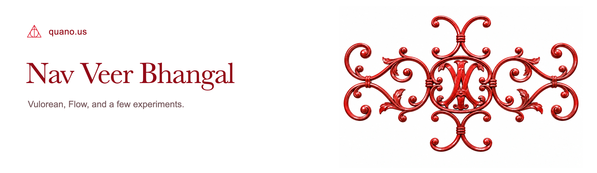

<picture>
  <source media="(max-width: 600px)" srcset="assets/header-mobile.png">
  
</picture>

  
  

I'm building [Vulorean](https://vulorean.com). The smaller projects live here.

### Projects

| Project | What it does |
| --- | --- |
| [Vulorean](https://vulorean.com) | Property tax appeals, built around the homeowner. |

### On GitHub

| Repository | What it does |
| --- | --- |
| [Grammer](https://github.com/bnavveer/grammer) | Fix grammar or strip formatting with a keyboard shortcut. |
| [ion-cli](https://github.com/bnavveer/ion-cli) | A TypeScript CLI for inventory, issues, and runs in ION. |
| [GovDeals scraper](https://github.com/bnavveer/govdeals-scraper) | Search auctions by location, estimate resale prices, and export to CSV. |

[Message me on X](https://x.com/messages/compose?recipient_id=1227365380986818560) · [Email](mailto:bnavveer@pm.me) · [quano.us](https://quano.us)
